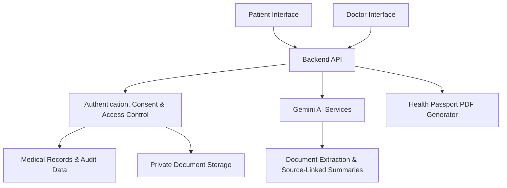

<div align="center">

# MedVault

### Your Health. One Secure Vault.

**An AI-powered platform for unified medical records, intelligent clinical insights, and patient-controlled data sharing.**

</div>

---

## Overview

Medical histories are frequently distributed across hospitals, clinics, prescriptions, and diagnostic reports. This fragmentation makes it difficult for healthcare professionals to understand a patient's complete history and for patients to access and share their own records.

**MedVault** brings medical documents and information into a single, searchable workspace. Patients can digitize and organize their records, review AI-extracted information, control access granted to doctors, and export a portable health summary. Authorized doctors can explore a consolidated medical timeline, review source-linked summaries, and identify discrepancies that may require clinical attention.

The current implementation uses **synthetic patient data and simulated hospital sources**. It is not connected to live hospital record systems.

## The Problems MedVault Addresses

1. **Fragmented cross-hospital clinical context (PS1):** Doctors cannot easily access consolidated patient medical histories across separate hospital systems, leading to missed lab trends and unflagged allergy contradictions.
2. **Limited patient portability (PS2):** Patients struggle to gather, organize, and carry portable digital copies of their own medical reports, prescriptions, and discharge summaries.

MedVault connects these two problems directly through five implemented workflows using synthetic multi-hospital records (no live external hospital EHR integration):

| Problem | Implemented MedVault Solution |
| --- | --- |
| **PS1: Doctors lack cross-hospital histories** | **Consent-Controlled Doctor Access** (`Full History` vs. `Labs & Allergies Only` scopes + instant revocation) and **Source-Linked Clinical Summaries** with verbatim source evidence and cross-hospital allergy discrepancy alerts. |
| **PS2: Patients lack portable digital records** | **AI-Powered Digitization** (PDF/image upload with human verification), a searchable **Unified Medical Timeline**, and a one-click **Portable Health Passport PDF** export. |

## Key Features

| Capability | Description |
| --- | --- |
| **Unified Health Dashboard** | Consolidated overview of medical records, participating facilities, recent activity, and relevant clinical information. |
| **Medical Record Timeline** | Chronological records with keyword search and filters for hospital and document category. |
| **AI Document Extraction** | Extracts structured information from supported medical PDFs and images using Google Gemini. |
| **Patient Verification** | Allows extracted allergies, observations, and medications to be reviewed and corrected before verification. |
| **Doctor Workspace** | Displays an authorized patient's records within the access scope approved by the patient. |
| **Consent Management** | Supports access requests, approval, restricted sharing, revocation, and access audit events. |
| **AI Clinical Summary** | Produces concise, source-linked summaries of information available to an authorized doctor. |
| **Discrepancy Detection** | Highlights conflicting allergy documentation across records for professional review. |
| **Health Passport PDF** | Exports a consolidated health summary with record references, documented allergies, medications, and laboratory history. |
| **Service Fallback** | Provides a clearly labeled, pre-generated example summary for the unchanged synthetic dataset when live AI is unavailable, subject to the same consent restrictions. |
| **Responsive Interface** | Supports desktop and mobile screen sizes. |

### Patient Experience

Patients can upload and organize medical documents, review extracted information, browse their history across facilities, export a Health Passport, and manage which doctors are permitted to access their information.

### Doctor Experience

Authorized doctors can view the permitted medical timeline, inspect original source records, review discrepancy flags, and generate or access a clinical summary grounded in the records currently available to them.

## Technology Stack

| Layer | Technology |
| --- | --- |
| Frontend | React, TypeScript, Vite |
| Backend | Node.js, TypeScript |
| AI | Google Gemini via `@google/genai` |
| PDF generation | `pdf-lib` |
| Data persistence | Local JSON data store |
| Document storage | Private server-side filesystem storage |
| Quality assurance | TypeScript checks, production builds, API tests, Playwright |
| Development environment | Google AI Studio |

## System Architecture



**Core implementation modules**

```text
src/
  App.tsx                  Application state and navigation
  api.ts                   Client API requests
  types.ts                 Shared frontend types
  components/              Patient, doctor, records, AI, and consent views

server.ts                  Backend routes and access-control logic
server/
  store.ts                 Record storage and synthetic dataset
  gemini.ts                AI extraction and summary generation
  pdfGen.ts                PDF document generation
  sampleSummary.ts         Permission-aware example-summary fallback
```

## Getting Started

### Prerequisites

- Node.js and npm
- A Google Gemini API key for live AI functionality

### Installation

Clone your repository and install the dependencies:

```bash
git clone https://github.com/yuvraj-makani/MedVault.git
cd MedVault
npm install
npm run dev
```

### Environment Configuration

Configure the Gemini API key in the **server environment**:

```env
GEMINI_API_KEY=your_gemini_api_key
```

Keep credentials out of source control. Use an environment file supported by your setup or configure the variable in your hosting environment. The API key must not be exposed in client-side code.

### Start the Application

```bash
npm run dev
```

Open the URL printed by the development server. Ensure the application backend is running alongside the frontend if your environment starts them separately.

### Build, Type-Check & Automated Tests

```bash
npm run build
npm run lint
npm test
```

`npm test` runs the offline deterministic AI reliability, citation-grounding, PDF export, and HTTP consent-enforcement test suite (`tests/evaluate.ts`). See [docs/PROMPT_ENGINEERING.md](docs/PROMPT_ENGINEERING.md) for documented prompts, safety rules, and evaluation details.

## Selected API Routes

| Endpoint | Purpose |
| --- | --- |
| `GET /api/patient/dashboard` | Retrieve the patient's dashboard data. |
| `GET /api/records` | Retrieve records permitted for the current user. |
| `POST /api/records/extract` | Extract structured details from a medical document. |
| `POST /api/records` | Save a medical record. |
| `PATCH /api/records/:id/verify` | Mark a reviewed extraction as verified. |
| `GET /api/records/:id/file` | Retrieve an authorized private document. |
| `GET /api/consents` | Retrieve consent information. |
| `POST /api/consents/request` | Request access to patient information. |
| `GET /api/doctor/overview` | Retrieve a consent-filtered doctor overview. |
| `POST /api/doctor/ai-summary` | Generate a source-linked clinical summary. |
| `POST /api/doctor/ai-summary/sample` | Retrieve an authorized, labeled example summary. |
| `GET /api/patient/health-passport` | Export the patient's Health Passport PDF. |

Protected endpoints are subject to backend role and consent checks.

## Privacy and Access Control

MedVault's current implementation includes:

- Backend-enforced role-based access and patient-approved consent scopes.
- Restricted views for **Full History** and **Labs & Allergies Only** permissions.
- Server-side redaction of information outside the granted scope.
- Access revocation and invalidation of permission-sensitive AI summaries.
- Audit events for document access and consent changes.
- AI citation checks against records accessible to the requesting doctor.
- Private document storage outside publicly served static assets.
- Basic AI request rate limiting.

**Current deployment scope:** The application uses demonstration authentication and single-process local storage. Production use with real patient data would require stronger identity verification, durable storage, encryption and key management, operational monitoring, regulatory review, and security assessment.

## AI Design Principles

MedVault is designed to keep AI-generated information traceable to its source documents.

- Extracted data can be reviewed and corrected before being verified.
- AI summaries include source references wherever available.
- Unsupported citations are identified as unverified.
- Conflicting medical information is flagged for clinician review, not automatically resolved.
- Live AI availability depends on the configured Gemini service and quota.
- Example summaries are explicitly identified as pre-generated, and access remains permission-restricted.

AI-generated content is informational and should not replace professional clinical judgment.

## Testing

The project has undergone reported TypeScript, production-build, HTTP/API, and Playwright browser testing covering:

- Patient and doctor dashboards at desktop and mobile viewport sizes.
- Record upload, extraction review, verification, and timeline updates.
- Health Passport PDF generation and download.
- Consent approval, restricted sharing, and revocation enforcement.
- AI summary caching and source-reference handling.
- Example-summary fallback, dataset-change checks, and access restrictions.

These are development test results, not a formal security, medical, or regulatory certification.

## Roadmap

- Standards-based interoperability with participating providers, including HL7 FHIR-aligned data exchange.
- Evaluation of ABDM-compatible workflows and consent requirements.
- Production-grade database and encrypted object storage.
- Stronger authentication, session management, and granular time-limited access.
- Broader laboratory trend visualization and accessibility enhancements.
- Expanded automated testing, observability, and security validation.

## Repository Security

Exclude generated builds, local data, uploaded documents, and secrets from Git. At minimum, ensure your `.gitignore` covers:

```gitignore
node_modules/
dist/
.env
.env.*
!.env.example
storage/medvault-db.json
storage/private_uploads/
```

If a secret has already been committed, rotate it; removing it from a later commit does not remove it from repository history.

---

<div align="center">

**MedVault** · *Your Health. One Secure Vault.*

</div>
